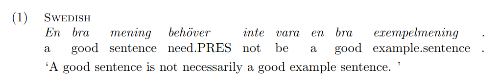
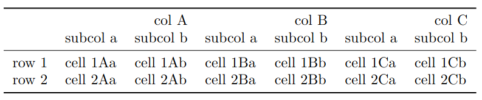

Things that make LaTeX definitely worth it, but that I have to look up every single time:

- [Compilers](#compilers)
- [Macros](#macros)
- [Resizing stuff to text/column width](#resizing-stuff-to-textcolumn-width)
- [Text size](#text-size)
- [Adding a full-page segment to a two-column paper](#adding-a-full-page-segment-to-a-two-column-paper)
- [Preventing page breaks](#preventing-page-breaks)
- [Adjusting margins](#adjusting-margins)
- [Multiline comments](#multiline-comments)
- [SVGs](#svgs)
- [Glossed linguistic examples](#glossed-linguistic-examples)
- [Ge\`ez and Latin script in the same document](#geez-and-latin-script-in-the-same-document)
- [Generating tables with Python](#generating-tables-with-python)
  - [Basic (non-nested) tables](#basic-non-nested-tables)
  - [Tables with subcolumns](#tables-with-subcolumns)

## Compilers

| if                                    | then     |
| ------------------------------------- | -------- |
| Multiple scripts in the same document | XeLaTeX  |
| Springer Nature template              | pdfLaTeX |

## Macros
Example macro with two arguments that creates a clean version of an unwieldy URL whilst retaining all the `https://`s and encoded mess in its clickable version:

```latex
\newcommand{\cleanurl}[2]{\href{#1}{\nolinkurl{#2}}}
% usage: \cleanurl{https://www.unwieldy.nope}{unwieldy.nope}
```

## Resizing stuff to text/column width
Essentially

```latex
\resizebox{\textwidth}{!}{whatever}
% replace \textwidth with \columnwidth as needed
% prepend 0.N to \xxxwidth if the content should be resized to a fraction of the given width
```

but for tables, the box should be around the `tabular` and __not__ wrap the entire `table` environment.

## Text size
The standard text sizes are:

```latex
\tiny
\scriptsize
\footnotesize
\small
\normalsize
\large
\Large
\LARGE
\huge
\Huge
```

The normal size can be set document-wise:
```latex
\documentclass[Xpt]{class}
```

Valid values of `X` for standard `class`es (`article`, `book`, `letter` and `report`) are 10 (default), 12 and 13.

To define a custom size:

```latex
\newcommand\justright{\fontsize{Xpt}{Ypt}\selectfont}
```

where `X` is the font size and `Y` is the default line skip size.

## Adding a full-page segment to a two-column paper
```latex
\onecolumn
```

## Preventing page breaks
Create an environment where page breaks are absolutely forbidden (the magic is from [StackOverflow](https://tex.stackexchange.com/questions/94699/absolutely-definitely-preventing-page-break)):

```latex
\newenvironment{nopagebreakswhatsoever}
    {\par\nobreak\vfil\penalty0\vfilneg
    \vtop\bgroup}
    {\par\xdef\tpd{\the\prevdepth}\egroup
    \prevdepth=\tpd}
```

Use it as:

```latex
\begin{nopagebreakswhatsoever}
    whatever should absolutely be all in the same page 
\end{nopagebreakswhatsoever}
```

## Adjusting margins
```latex
\usepackage[margin=Xin]{geometry}
```

## Multiline comments
(or something like that)

```latex
\iffalse
    whatever you don't wish LaTeX to compile
\fi
```

## SVGs
```latex
\includesvg{path/to/graphics.svg}
```

This relies on the following import:

```latex
\usepackage[inkscapeversion=auto]{svg}
```

which in turn relies on having Inkscape separately installed.


## Glossed linguistic examples
Add

```latex
\usepackage{covington}
```

and optionally

```latex
\setglossoptions{
    fspreamble=\scshape\small, % style of the pre-gloss text
    fsi=\itshape,              % style of the main text
    fsii=\normalfont}          % style of the gloss
```

(there is also a bunch of other options, described in the ~~awfully long~~ incredibly thorough `covington` package [docs](https://ctan.math.washington.edu/tex-archive/macros/latex/contrib/covington/covington.pdf); these are the ones I most commonly use)

Use as:

```latex
\begin{example}
    \label{utbildning}
    \digloss[preamble=Swedish]
        {En bra mening behöver inte vara en bra exempelmening .}
        {a good sentence need.PRES not be a good example.sentence .}
        {A good sentence is not necessarily a good example sentence. }
\end{example}
```

which will render as
 


`\trigloss`es are also possible.

## Ge`ez and Latin script in the same document
```latex
\usepackage{polyglossia}
\usepackage{microtype, newunicodechar}
\usepackage[sf, bf, big]{titlesec}
\defaultfontfeatures{Scale=MatchUppercase}
\setmainfont{Abyssinica SIL}[Scale=1]
\setsansfont{Libertinus Sans}
\setmainlanguage{english}
\setotherlanguage{amharic}
\newunicodechar{፡}{፡\ }
\newunicodechar{።}{\@{።} }
\newunicodechar{፣}{፣ }
\newunicodechar{፤}{፤ }
\newunicodechar{፥}{፥ }
\newunicodechar{፦}{፦ }
\newunicodechar{፧}{\@{፧} }
\newunicodechar{፨}{\@{፨} }
\newunicodechar{፠}{\@{፠} }
\newfontfamily{\amharicfont}{Abyssinica SIL}[
  Script=Ethiopic,
  Ligatures=Common,
  WordSpace = {0.1,30.0,1.0}]
```

## Generating tables with Python
Many LaTeX users use GUI table generators like [this](https://www.tablesgenerator.com/).
A much more powerful option that handles subcolumns and other annoyances flawlessly is to generate tables in Python using the Pandas library. 
This is especially practical when the data to put in the table comes from a Python script.
So, `import pandas` and...

### Basic (non-nested) tables 
Store your data as a `DataFrame` and run `.to_latex()` on it.
A dictionary can be easily converted into a `DataFrame`:

```python
df = pandas.DataFrame(a_dict) # dict -> DataFrame
df.to_latex()                 # DataFrame -> LaTeX string
```

### Tables with subcolumns
```python
def nd2df(nd, f=lambda cell: cell): # nested dictionary -> DataFrame 
    rows = nd.keys()
    ddf = {}
    for row in rows:
        cols = nd[row].keys()
        for col in cols:
            subcols = nd[row][col]
            for cell in subcols:
                nd[row][col][cell] = f(nd[row][col][cell])
        ddf[row] = pandas.DataFrame(nd[row])
    df = pandas.concat(ddf).unstack() # .unstack() = subrows -> subcols
    return df
```

Given a dictionary such as

```python
test_dict = {
    "row 1" : {
        "col A" : {"subcol a" : "cell 1Aa", "subcol b" : "cell 1Ab"},
        "col B" : {"subcol a" : "cell 1Ba", "subcol b" : "cell 1Bb"},
        "col C" : {"subcol a" : "cell 1Ca", "subcol b" : "cell 1Cb"}
    },
    "row 2" : {
        "col A" : {"subcol a" : "cell 2Aa", "subcol b" : "cell 2Ab"},
        "col B" : {"subcol a" : "cell 2Ba", "subcol b" : "cell 2Bb"},
        "col C" : {"subcol a" : "cell 2Ca", "subcol b" : "cell 2Cb"}
    }
}
```

this function can be used as `nd2df(test_dict).to_latex()`, which produces a LaTeX snippets that renders as 



Note that:

- the optional parameter `f` can be used to apply arbitrary edit operations to all cells. I usually use it to round numbers, but in this case a possible application is to remove the word "cell" to make the table more compact: `nd2df(test_dict, f=lambda cell: cell.replace("cell ", "")).to_latex()`
- `DataFrames` can also be used to generate tables in other formats too. All it takes is replacing `.to_latex()` with `.to_html()`, `.to_markdown()` etc., but not all formats have the best support for subcolumns. In Markdown, for instance, you get a comprehensible but not as pretty table:

  |       | ('col A', 'subcol a') | ('col A', 'subcol b') | ('col B', 'subcol a') | ('col B', 'subcol b') | ('col C', 'subcol a') | ('col C', 'subcol b') |
  | :---- | :-------------------- | :-------------------- | :-------------------- | :-------------------- | :-------------------- | :-------------------- |
  | row 1 | cell 1Aa              | cell 1Ab              | cell 1Ba              | cell 1Bb              | cell 1Ca              | cell 1Cb              |
  | row 2 | cell 2Aa              | cell 2Ab              | cell 2Ba              | cell 2Bb              | cell 2Ca              | cell 2Cb              |
